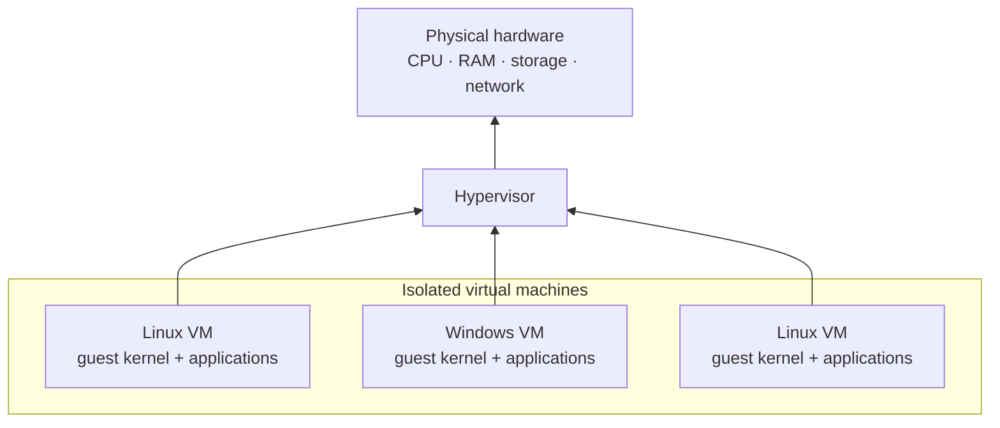
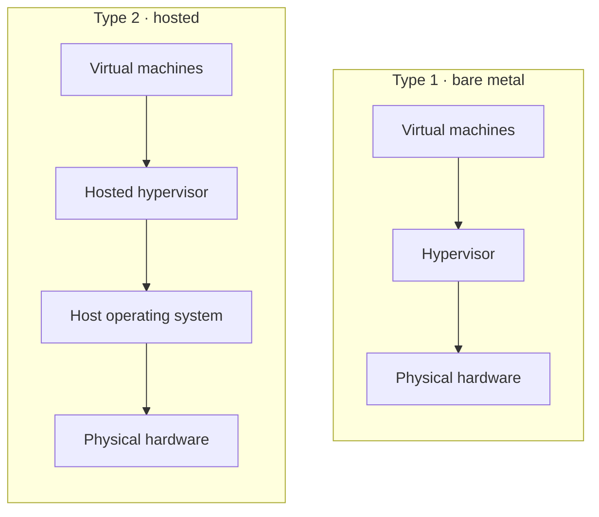
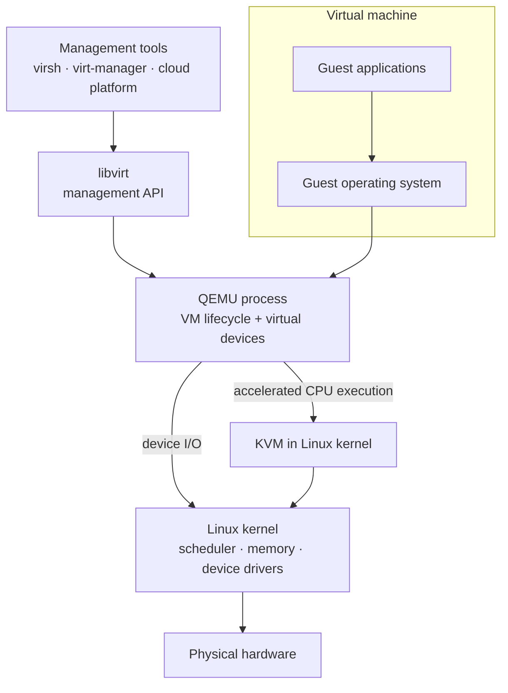
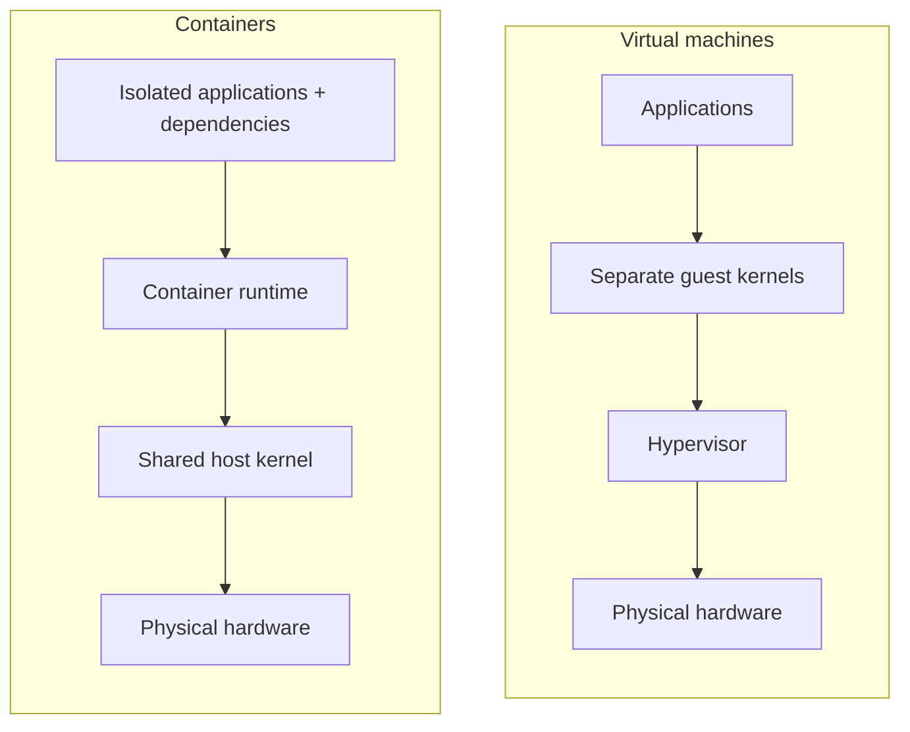

## Summary

A hypervisor lets multiple isolated virtual machines share one physical computer. Each VM behaves like a complete computer with its own operating-system kernel, while the hypervisor mediates access to CPU time, memory, storage, and networking.

## Explanation

An operating system normally expects privileged control of the machine. A hypervisor presents each guest operating system with virtual hardware and maps its operations onto the physical host:

The hypervisor schedules each VM's **virtual CPUs (vCPUs)** on physical CPU cores, maps guest memory to physical RAM, and supplies virtual devices such as disks and network adapters. Assigning four vCPUs gives a VM four schedulable virtual processors; it does not necessarily reserve four physical cores.

Modern processors make this efficient through hardware virtualization features such as Intel VT-x and AMD-V. Guest code can execute many instructions directly on the CPU, while privileged operations transfer control to the hypervisor. Hardware-assisted address translation, such as Intel EPT or AMD NPT, similarly helps isolate and translate guest memory.

### Type 1 and Type 2 hypervisors

- A **Type 1 (bare-metal) hypervisor** runs at the system's lowest software layer and manages hardware directly. It is typical of servers and cloud infrastructure. Examples include VMware ESXi, Xen, and Hyper-V.
- A **Type 2 (hosted) hypervisor** runs as an application on a conventional host operating system. The host continues to run ordinary applications alongside the VMs. Examples include VirtualBox and VMware Workstation.

This distinction is a useful mental model, not a perfect taxonomy. Modern virtualization stacks often divide responsibilities among a kernel, user-space device models, and management tools.

### KVM, QEMU, and libvirt

**KVM (Kernel-based Virtual Machine)** adds hardware-assisted virtualization capabilities to the Linux kernel. Linux retains its normal CPU scheduling, memory management, and device infrastructure while also running guest virtual machines.

KVM is commonly paired with:

- **QEMU**, which provides the VM process and emulates or virtualizes devices. With KVM acceleration, compatible guest CPU instructions run on the physical CPU rather than being fully emulated.
- **libvirt**, which provides a management interface used to define, start, stop, and monitor VMs across KVM/QEMU and other virtualization systems.

KVM is commonly called a Type 1 hypervisor because virtualization is implemented in the host kernel, although Linux remains a full operating system and may run ordinary applications. Its layered design does not fit the simple Type 1/Type 2 distinction as neatly as a standalone bare-metal product.

### Virtual machines and containers

VMs virtualize a machine boundary: each VM has its own kernel and can run a different guest operating system. Containers isolate processes while sharing the host kernel. Containers therefore tend to start faster and consume fewer resources, while VMs provide a stronger boundary and greater operating-system flexibility.

The two approaches are complementary. Cloud platforms commonly run containers inside VMs, using VMs for tenant or infrastructure isolation and containers for application packaging and deployment.

Virtualization is foundational to Infrastructure as a Service because providers can provision, resize, and remove isolated computers without dedicating a physical server to each customer. It is only one part of cloud computing, which also requires networking, storage, orchestration, security, and automation.

## Example

Suppose a server has 32 CPU cores and 128 GB of RAM. A provider might run three customer VMs on it: an 8-vCPU Linux web server, a 12-vCPU Windows application server, and a 16-vCPU Linux analytics server. The total assigned vCPUs may exceed the number of physical cores because the hypervisor schedules them over time; RAM allocation and overcommit policies are managed separately. Each customer sees an independent machine even though the workloads share hardware.

This differs from dual booting: a dual-boot computer has multiple operating systems installed but runs only one at a time, whereas virtualization runs multiple guest systems concurrently.

## Connections

- Contrasts with the language-runtime meaning of VM: [[Bytecode virtual machine]]
- Used by: cloud infrastructure, local development environments, and server consolidation
- Related: containers, Infrastructure as a Service, operating-system isolation
