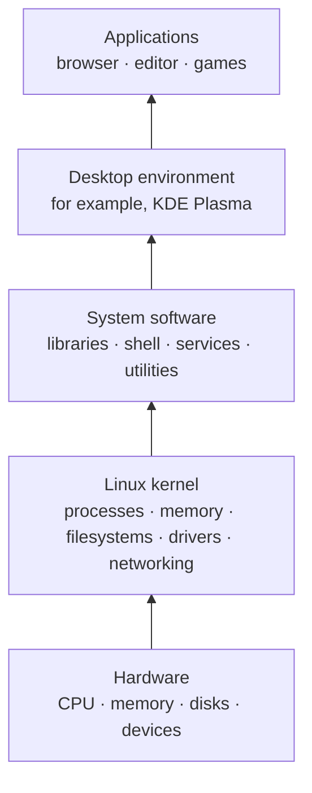

## Summary

Linux is strictly the **kernel**: the core software that manages a computer's hardware and lets programs use it safely. What people casually call “Linux” is usually a complete operating system assembled from the Linux kernel, system tools, applications, and often a graphical desktop environment.

## From hardware to a usable system

An **operating system** is the software layer that makes a computer usable. It decides which programs get processor time and memory, stores and retrieves files, communicates with devices, connects to networks, and gives applications common services so each program does not need to control the hardware itself.

The **kernel** is the privileged part closest to the hardware. Programs ask it to perform operations such as opening a file, sending network data, allocating memory, or drawing through a device driver. Linux is one kernel; it is not, by itself, the whole system a person installs and uses.

### The input-output loop

Read the diagram as a loop: a person provides input through devices such as a keyboard or mouse; kernel subsystems and user-space software process it; output devices return visual, audio, or physical feedback. The gaming and VR details illustrate this broader relationship. **User space** is where applications and supporting libraries run; **kernel space** is where the kernel and its drivers perform privileged work.

Image: Shmuel Csaba Otto Traian (ScotXW), [Linux kernel and gaming input-output latency](https://commons.wikimedia.org/wiki/File:Linux_kernel_and_gaming_input-output_latency.svg), [CC BY-SA 3.0](https://creativecommons.org/licenses/by-sa/3.0/).

## Unix and Unix-like systems

**Unix** is an operating-system family that originated at [Bell Labs in 1969](https://www.unix.org/unix_history.html). Its design supports multiple users and concurrent programs, organizes files in a hierarchy rooted at `/`, and provides small tools that can be combined through a command-line shell.

Linux-based operating systems are **Unix-like**: they follow many Unix interfaces and conventions without requiring the original Unix source code. For example, Ubuntu lets a user combine commands with a pipe (`|`), passing one program's output to another. Unix-like describes this resemblance; the **UNIX** name is also a trademark reserved for systems certified under [The Open Group's UNIX certification program](https://www.opengroup.org/certifications/unix).

## GNU and free software

The **GNU Project** began in 1983 to build a Unix-like operating system whose users could control and modify it. It produced many important system components, including the Bash shell, the GNU C Library, Coreutils, GCC, GDB, and Make. GNU also developed the GNU General Public License (GPL), a widely used free-software license.

When the Linux kernel appeared in 1991, it could be combined with GNU components and other software to make a complete Unix-like system. For this reason, the Free Software Foundation calls many such systems **GNU/Linux**. Not every Linux-based system uses a typical GNU user space—Android is a notable example—so “Linux-based operating system” is the broader description.

**Free software** refers to freedom, not necessarily a price of zero. Users must be allowed to run the software for any purpose, study and change its source code, share copies, and share modified versions. **Open source** emphasizes the practical development model and licenses that make source code available. The movements have different philosophies, but most software described by one term also satisfies the other; **FOSS** is a convenient umbrella term.

## Distributions and desktop environments

A **Linux distribution**, or distro, packages the kernel with selected system software, applications, an installer, a package manager, update repositories, and default configuration. Distributions such as Debian, Fedora, Ubuntu, and Arch can use the same Linux kernel while making different choices about release schedules, package formats, defaults, and support.

A **desktop environment** is a graphical user interface that lets people interact with the underlying operating system through visible elements such as windows, icons, panels, menus, settings, notifications, and a file manager. It provides a human-friendly alternative to performing tasks by typing commands into a command-line shell, although both interfaces ultimately use the same underlying system services. The desktop environment sits above the operating-system foundations and can usually be replaced without changing the kernel. KDE is the community that develops **Plasma**, while **GNOME** is another widely used desktop environment. A distribution may offer Plasma, GNOME, another desktop, or no graphical desktop at all.

### Ubuntu flavors

[Ubuntu flavors](https://ubuntu.com/desktop/flavors) are officially recognized, community-developed variants of Ubuntu. They share Ubuntu's underlying system and package repositories but offer different desktop environments, default applications, or specialized purposes. For example, **Kubuntu** uses KDE Plasma, **Xubuntu** uses Xfce, and **Lubuntu** uses LXQt; **Ubuntu Studio** focuses on audio, video, and graphics production. A flavor provides these choices as a ready-to-install system.

## Example

Kubuntu combines the Linux kernel, many GNU and other system components, Ubuntu's package repositories and tools, and KDE Plasma. The kernel communicates with the laptop's hardware; system services manage networking and login; Plasma provides the visible desktop; and applications run on top. Together these layers form the usable operating system that people commonly call “Linux.”

## Connections

- Related: [[Hypervisors and virtual machines]], [[Ahead-of-time compilation (AOT)]], [[Terminals, shells, and command-line interfaces]]
- Sources: [[How to Linux - Videos 1–100]], [Linux Kernel Organization — About Linux](https://www.kernel.org/linux.html), [GNU in a Nutshell](https://www.gnu.org/gnu/about-gnu.html.en), [GNU — What is Free Software?](https://www.gnu.org/philosophy/free-sw.en.html), [KDE — About KDE](https://kde.org/community/whatiskde/)
