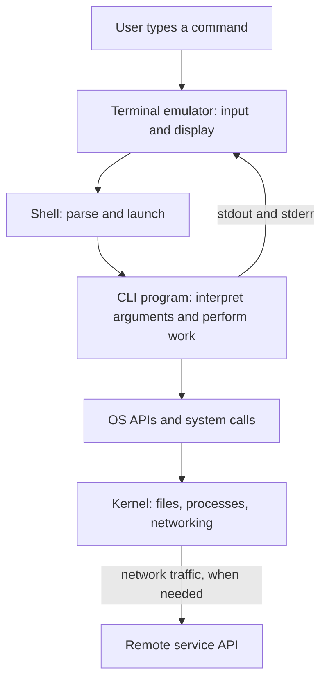

## Summary

A **command-line interface (CLI)** is a way to interact with a program by entering text commands. It can appear inside a graphical application as well as in a terminal. In a typical terminal session, a shell interprets command lines and coordinates programs that may work locally or communicate with remote services.

## Explanation

### Command interfaces beyond the terminal

The defining idea is **expressing an action through text that a program interprets**, rather than selecting the action through graphical controls. A CLI does not require a terminal emulator or an operating-system shell.

For example, a game's command console might accept `give weapon` to grant an item. This illustrative command goes to the game's own command interpreter, which changes game state. Likewise, a developer console or an application's command field can expose commands within an otherwise graphical interface. A program can offer both GUI and CLI interaction.

A browser's address/search bar is a useful analogy: typing a URL or search query asks the program to navigate or search. It is usually called an address/search interface rather than a CLI, because ordinary queries are input data rather than an explicit command language. The broader category is **text-based interaction**; command-line interaction is one form of it. Typing prose into a document is also text input, but does not make the editor a CLI.

### Terminal, shell, and CLI

| Concept | Responsibility | Examples |
| --- | --- | --- |
| **Terminal emulator** | Accepts keyboard input and displays program output, including text, colors, and cursor movement. | GNOME Terminal, Konsole, macOS Terminal |
| **Shell** | Interprets command syntax, expands variables, sets up pipes and redirection, and runs built-in commands or external programs. | Bash, Zsh, PowerShell |
| **CLI** | Defines the text commands, arguments, and options through which a program exposes its functions. | `git`, `brew`, `aws`, `databricks` |

A graphical terminal emulator recreates the behavior of older physical terminals: devices with a keyboard and display connected to a computer. Its window is a graphical interface around a text session; the shell supplies the command language. The same terminal application can run different shells or other interactive programs.

### What is a shell?

A **shell** is a computer program that provides an interface to operating-system services and utilities. It lets a human user, script, or another program request actions such as navigating files, starting programs, and coordinating their input and output. A service can invoke a shell to execute a script, although programs can also use OS APIs without one.

In this note, **shell** means a command-line shell such as Bash or Zsh: a command interpreter with a scripting language. It exposes a **CLI**, the form of interaction; the shell is the program implementing that interface. The term also has a broader use: a **graphical shell** exposes system functions through desktop controls rather than a command language.

#### Shell versus kernel

The **kernel** manages resources and enforces access to files, processes, memory, and devices. A shell runs in **user space**, using kernel services under the permissions of the account running it. Replacing Bash with Zsh changes the command interpreter, not the kernel.


Image: Dave Kerr, [Effective Shell — What is a Shell?](https://effective-shell.com/part-2-core-skills/what-is-a-shell/). The arrows show the terminal passing input to the shell and the shell launching `tree`, a program that lists directory contents. Each of these programs can request kernel services; the shell is not a mandatory intermediary for every system call.

For example, when the shell launches `git status`, Git interprets `status` and requests the filesystem operations it needs. The shell coordinates execution; Git supplies its own CLI vocabulary; the kernel supplies underlying system services.

### What a command line expresses

A command line names an operation and supplies the information needed to perform it. A common pattern is `program subcommand [options] [operands]`, although each tool defines its own syntax. The brackets in this notation indicate optional parts; they are not typed literally.

In `git status --short`, `git` identifies the program, `status` selects an operation, and `--short` changes the output format. The shell launches Git with those arguments, and Git interprets them. In `cp report.txt backup.txt`, the two filenames are operands identifying the source and destination. Quotes keep an argument containing spaces together, as in `cp "meeting notes.txt" backup.txt`.

In an interactive shell, a **prompt**, often ending in `$`, `%`, or `>`, indicates that the shell is ready for input. The user enters a command, receives output or an error, and gets another prompt when the foreground command finishes. The prompt is not part of the command. A CLI therefore offers a repeatable text vocabulary for actions that a GUI might expose through buttons or menus.

A terminal can also host a **text-based user interface (TUI)** with menus, panels, and keyboard navigation, such as `htop`. Displaying text in a terminal does not by itself make an interface a command line.

### From a command to operating-system work

For a typical external command on a Unix-like system:

1. The terminal passes input to the shell through an OS-managed **pseudoterminal**, a software terminal connection.
2. The shell parses the command, processes quoting and expansions, and resolves the program. For a command such as `git`, it normally searches the directories listed in the `PATH` environment variable.
3. The shell arranges a process to run the program using operating-system facilities. On Linux, an `execve` system call loads the program into a process, replacing that process's previous program.
4. The program performs its own logic on the CPU. When it needs services such as reading files or sending network data, it uses OS APIs, often through libraries that invoke **system calls** into the kernel.
5. Output normally goes to **standard output** or **standard error**, which the terminal displays. When the command finishes, its exit status lets the shell or a script determine whether it succeeded.

The shell can handle a built-in command without launching a separate executable. For example, `cd` changes the current shell's working directory so subsequent commands use that location. An external program cannot change its parent shell's directory.



This flow describes an interactive session. Automation such as [[GitHub Actions]] can run a shell and CLI tools without a visible terminal window.

### GUI counterpart: copying a file

A **graphical user interface (GUI)** expresses actions through windows, buttons, and menus. To copy a file, a user can select **Copy** and **Paste** in a file manager or run `cp report.txt backup.txt` in a shell. Both paths ultimately ask the operating system to read the source file and write the destination:

| Interface | Path to the operation |
| --- | --- |
| GUI | Click Copy/Paste → file manager handles the action → OS APIs and system calls → filesystem |
| CLI | Type `cp report.txt backup.txt` → shell launches `cp` → OS APIs and system calls → filesystem |

The file manager can call filesystem APIs through libraries directly, without constructing a shell command. Some GUI applications do launch CLI tools internally, but that is an implementation choice. The shell is one way to coordinate programs; graphical applications can also request OS services without it.

### Local tools and remote service clients

| CLI | Example | What performs the work |
| --- | --- | --- |
| Git | `git status` | Git examines the local working tree and repository through filesystem operations. Commands such as `git fetch` also contact a remote repository. |
| Homebrew | `brew install git` | Homebrew coordinates downloading, installing, and sometimes building software locally. The installed `git` program can then be found through `PATH` when configured accordingly. |
| AWS CLI | `aws s3 ls` | A local client uses configured credentials to request information from AWS service APIs over the network. |
| Databricks CLI | `databricks jobs list` | A local client uses configured authentication to request job information through the Databricks REST API. |

A **system call** requests a service from the local kernel. A **remote API request** asks another service to do work; it travels over networking facilities provided by the local OS. Both can happen during one CLI command.

## Example

```sh
git status --short > changes.txt
```

The shell recognizes `>` and redirects Git's standard output to `changes.txt`. Git receives `status` and `--short`, examines the repository, and writes its result. The terminal therefore shows no normal output, while standard error can still appear there. The shell connects the program to a file without Git needing to implement redirection syntax.

Similarly, a pipe (`|`) connects one command's standard output to another's standard input. Shell scripts combine these mechanisms with variables, conditions, and loops to automate work. Saving commands as a script makes a sequence repeatable without manually clicking through each action; the tools' output and exit statuses let later steps use results or react to failures.

## Connections

- Foundations: [[Linux-based operating systems]]
- Used by: [[Make and Makefiles]], [[GitHub Actions]]
- Sources: [GNOME Terminal introduction](https://help.gnome.org/gnome-terminal/introduction.html), [Bash reference manual](https://www.gnu.org/software/bash/manual/bash.html), [Linux execve manual](https://www.man7.org/linux/man-pages/man2/execve.2.html)
- CLI references: [Git](https://git-scm.com/docs/git), [Homebrew](https://docs.brew.sh/Manpage), [AWS CLI](https://docs.aws.amazon.com/cli/latest/userguide/cli-chap-welcome.html), [Databricks CLI](https://docs.databricks.com/aws/en/dev-tools/cli)
